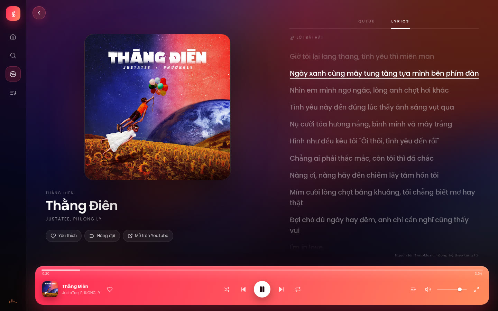

# Nhạc Nhẽo Web

Web app nghe nhạc từ YouTube Music, không quảng cáo, không cần tài khoản. Giao diện lấy cảm hứng từ bản Nhạc Nhẽo/SimpMusic trong ảnh tham chiếu: nền ảnh bìa mờ, lời chạy theo từng từ, hàng đợi bên phải và thanh phát nổi ở cuối màn hình.



## Tính năng

| Nhóm | Nội dung |
|---|---|
| Khám phá | Trang chủ gợi ý, album, playlist, nghệ sĩ, tìm kiếm YouTube Music |
| Phát nhạc | Proxy âm thanh qua server, seek bằng Range request, tự chuyển bài, up next |
| Lời bài hát | Đồng bộ theo dòng và theo từng từ, lấy từ SimpMusic Lyrics, fallback LRCLIB |
| Điều khiển | Hàng đợi, shuffle, repeat, âm lượng, Media Session, phím tắt |
| Lưu trữ | Hàng đợi, âm lượng, bài yêu thích trong localStorage |
| Giao diện | Desktop và mobile, nền ảnh bìa mờ, chuyển bài có crossfade |

## Yêu cầu

Máy cần Node 20.19 trở lên, khuyến nghị Node 22. Cần `yt-dlp` trong PATH để giải URL phát nhạc. Nên cài thêm `ffmpeg` để `yt-dlp` xử lý tốt hơn. Cần kết nối Internet tới YouTube Music, SimpMusic Lyrics và LRCLIB.

```bash
pipx install yt-dlp
sudo apt install ffmpeg
```

## Chạy môi trường dev

```bash
npm install
npm run dev
```

Mở http://localhost:5173. API chạy ở cổng 8787, Vite proxy các request `/api` sang đó.

## Chạy production

```bash
npm run build
npm start
```

Mở http://localhost:8787. Server Express phục vụ cả API và file tĩnh trong `web/dist`.

## Biến môi trường

| Tên | Mặc định | Ý nghĩa |
|---|---|---|
| `PORT` | `8787` | Cổng của API và server production |
| `YTDLP_COOKIES` | trống | Đường dẫn file cookies.txt nếu YouTube chặn IP của server |
| `YTDLP_EXTRACTOR_ARGS` | trống | Tham số extractor cho yt-dlp, ví dụ `youtube:player_client=visionos,web` |

Ví dụ:

```bash
YTDLP_COOKIES=./cookies.txt npm start
```

## Kiến trúc

| Thành phần | Công nghệ | Nhiệm vụ |
|---|---|---|
| Giao diện | React 19, Vite, CSS thuần | Home, Search, Now Playing, Queue, Lyrics |
| Trạng thái | Zustand | Hàng đợi, bài hiện tại, phát dừng, lặp, shuffle, âm lượng |
| Metadata | youtubei.js | Tìm kiếm, trang chủ, album, playlist, artist, up next |
| Giải URL stream | yt-dlp | Trả URL googlevideo, cache trong bộ nhớ |
| Proxy âm thanh | Express + fetch | Chuyển tiếp Range request, giữ URL và IP phía server |
| Lời bài hát | SimpMusic Lyrics, LRCLIB | Chuẩn hóa LRC theo dòng và theo từ |

Luồng phát một bài: frontend gọi `/api/song/{videoId}` và `/api/lyrics/{videoId}`. Thẻ audio trỏ tới `/api/stream/{videoId}`. Server kiểm tra cache URL, nếu chưa có thì chạy `yt-dlp -g`, sau đó gọi googlevideo với header `Range` của trình duyệt và stream ngược về. Khi hàng đợi gần hết, frontend gọi `/api/upnext/{videoId}` để nối thêm bài.

Phân tích ngược bản gốc, lý do chọn kiến trúc và các rủi ro kỹ thuật nằm trong [docs/rea.md](docs/rea.md).

## API

| Endpoint | Chức năng |
|---|---|
| `GET /api/health` | Kiểm tra server |
| `GET /api/home` | Các shelf gợi ý |
| `GET /api/search?q=&type=` | Tìm `songs`, `albums`, `artists`, `playlists`, `videos` |
| `GET /api/album/:id` | Chi tiết album và danh sách bài |
| `GET /api/playlist/:id` | Chi tiết playlist và danh sách bài |
| `GET /api/artist/:id` | Nghệ sĩ, bài hàng đầu, album |
| `GET /api/song/:id` | Metadata một bài |
| `GET /api/upnext/:id` | Danh sách phát tiếp theo |
| `GET /api/lyrics/:id` | Lời bài hát đã chuẩn hóa |
| `GET /api/stream/:id` | Proxy âm thanh, hỗ trợ Range |

## Phím tắt

| Phím | Tác dụng |
|---|---|
| `Space` | Phát hoặc tạm dừng |
| `←` `→` | Tua lùi hoặc tiến 5 giây |
| `N` | Bài tiếp theo |
| `P` | Bài trước |
| `M` | Tắt hoặc bật tiếng |
| `/` | Mở tìm kiếm |
| `Esc` | Về trang chủ |

## Giới hạn đã biết

Chưa hỗ trợ đăng nhập Google, playlist cá nhân, tải offline hay đồng bộ nhiều thiết bị. Danh sách phát tiếp theo phụ thuộc YouTube Music nên có thể khác giữa các lần. Lời bài hát do bên thứ ba cung cấp nên có bài thiếu, sai hoặc chưa đồng bộ. `yt-dlp` có thể hỏng khi YouTube thay đổi cơ chế chống bot; khi đó cần cập nhật `yt-dlp` hoặc truyền cookies qua biến môi trường. Server chưa có rate limit, chỉ nên dùng cho mục đích cá nhân.

## Pháp lý

Dự án không liên kết với Nhạc Nhẽo, SimpMusic, YouTube hay Google. Tên gọi chỉ mang tính tham chiếu. Dự án không lưu trữ hay đăng tải âm thanh. Nhạc được phát từ server của YouTube và thuộc về chủ sở hữu bản quyền. Phần mềm được cung cấp nguyên trạng, không bảo hành. Dùng client bên thứ ba có thể trái với điều khoản của YouTube; người dùng tự chịu trách nhiệm tuân thủ điều khoản và luật bản quyền nơi mình sống. Hãy cân nhắc đăng ký YouTube Premium hoặc mua nhạc để ủng hộ nghệ sĩ.

## Kiểm chứng

Các lệnh dưới đây đã chạy trên máy phát triển ngày 12/11/2026 và đều đạt.

```bash
npm run typecheck
npm run build
curl "http://localhost:8787/api/search?q=Thang%20Dien&type=songs"
curl -H "Range: bytes=0-8191" "http://localhost:8787/api/stream/iYLEWqRbp9M"
```

Kết quả tìm kiếm trả đúng bài `Thằng Điên` với `videoId iYLEWqRbp9M`. API lời trả 77 dòng, có `richSyncLyrics` theo từng từ. Proxy stream trả `206 Partial Content` với `Content-Range: bytes 0-8191/3790042`. Ảnh chụp giao diện nằm trong `docs/screenshot-now.jpg` và `docs/screenshot-home.jpg`.
